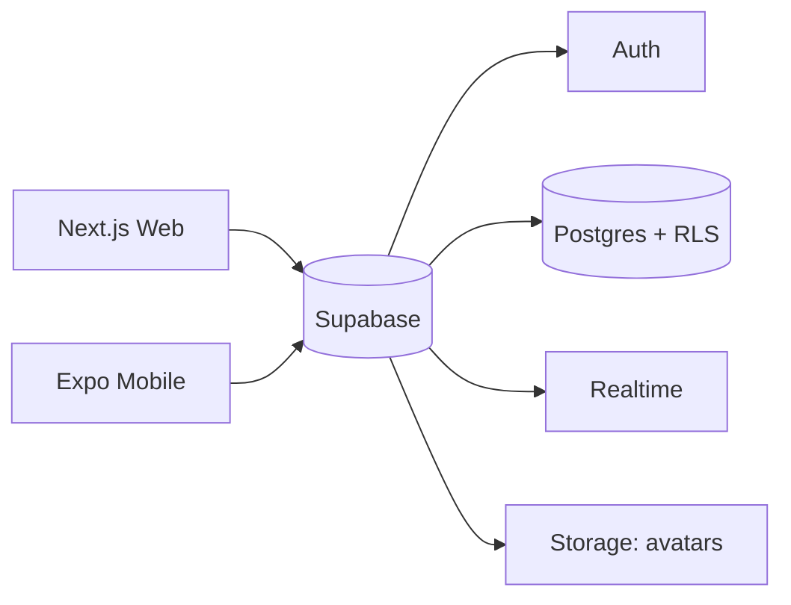
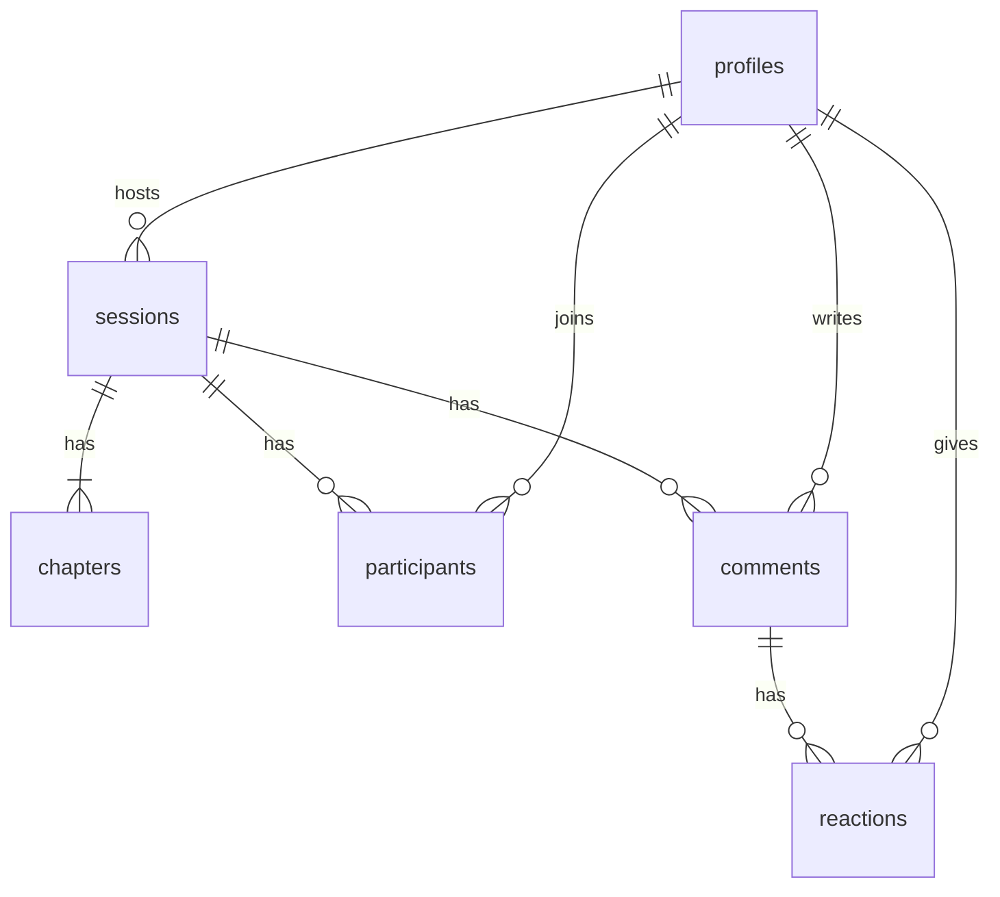

# Books & Friends – Project Spec (v1.0)

## 1. Overview
Books & Friends is a social reading app. Members create a **reading session** for one book, others join and report **progress by chapter** (shown as a progress bar), and everyone talks in a **single flat discussion thread** per session, with **emoji reactions** on comments.

**Platforms:** Web app + Mobile app (iOS/Android). **Backend:** Supabase.

## 2. Scope Decisions (v1.0)
| Topic | Decision |
|---|---|
| Tech stack | Next.js (TypeScript) web; React Native + Expo mobile; shared TS types/client in a monorepo |
| Session visibility | **All sessions are public** in v1.0. Private sessions (host chooses public/private, invite links) move to the next version |
| Host permissions | **None extra.** The host is a regular participant |
| Books per session | **Exactly one** |
| Progress | Counted in **chapters** (never pages), displayed as a **progress bar** |
| Discussion | **Flat**: one thread per session, no replies |
| Reactions | **Multiple emoji** per member per comment |
| Notifications | **Not in v1.0** (no in-app, push or email) |
| Search | **Not in v1.0** |
| Auth | Email + password (Supabase Auth); other methods open for later |

**Out of scope:** private sessions / invite links (next version), notifications, search, threaded replies, spoiler protection, moderation tools / host controls, book catalog API, direct messages, admin dashboard.

## 3. Users & Roles
- **Member**: any registered user. Can create sessions, join, update progress, comment, react.
- **Host**: the member who created a session. Same permissions as any participant.

## 4. Functional Requirements

### 4.1 Registration & Profile
- FR-1 Anyone can register with email + password (email verification).
- FR-2 Login, logout, password reset.
- FR-3 Profile: display name, avatar (optional). Edit own profile; delete own account (comments show "Deleted user").

### 4.2 Reading Sessions
- FR-4 A member creates a session by submitting: **book title** (required), **author** (required), **chapters** (required). Every session is public.
- FR-5 **Chapters:** an ordered list of chapter names, or a total count N that auto-generates "Chapter 1…N". Min 1, max 200.
- FR-6 One book per session. Title, author and chapters are fixed after creation (no edit/delete by anyone in v1.0).
- FR-7 **Home list:** shows all sessions, newest first, paginated. Tabs: "Discover" (all) and "Mine" (joined/hosted). No search or filters.
- FR-8 **Session detail:** book info, participant list with progress bars, discussion thread.
- FR-9 Sessions are readable by any logged-in member; posting and progress updates require joining.

### 4.3 Joining & Progress
- FR-11 Any member can join any session. Members can leave (their progress is removed; comments remain).
- FR-12 A participant updates their own progress by setting the number of **chapters completed** (0…N).
- FR-13 Progress is shown as a **progress bar** with label "x / N chapters" (percentage = x / N) for each participant. The user's own bar appears prominently at the top of the session.
- FR-14 Sessions list shows each session's participant count and the user's own bar for joined sessions.

### 4.4 Discussion
- FR-15 Each session has **one flat thread**. Participants can post text comments (max 2,000 chars).
- FR-16 Participants can edit (marked "edited") and delete **only their own** comments.
- FR-17 Chronological order (oldest to newest), with pagination and live updates (Supabase Realtime).

### 4.5 Reactions
- FR-18 Participants can react to any comment with **any emoji**, and can add **multiple different emoji** to the same comment. Same emoji can be added once per member per comment; tapping again removes it.
- FR-19 Comments show reactions grouped by emoji with counts; tap/hover shows who reacted.

## 5. Non-Functional Requirements
- **Security:** RLS on all tables; clients never hold the service-role key; HTTPS only; rate limits on comments/reactions; sanitize text.
- **Performance:** first load < 2.5s on 4G; comments feed p95 < 300ms; realtime < 1s.
- **Accessibility:** WCAG 2.1 AA (web); screen reader + dynamic type (mobile). Progress bars expose value text.
- **Privacy:** user can delete their account and data.
- **Reliability:** Supabase daily backups; Sentry error monitoring.
- **i18n:** English first, strings externalized.

## 6. Architecture

Clients use supabase-js directly under RLS. Postgres functions (RPC) handle atomic operations: create session with chapters, join session, toggle reaction. No Edge Functions are required for v1.0 other than account deletion.

## 7. Data Model (Postgres)

| Table | Key columns |
|---|---|
| `profiles` | id (= auth.users.id), display_name, avatar_url, created_at |
| `sessions` | id, host_id, book_title, book_author, chapter_count, created_at (next version adds `visibility` and `invite_code`) |
| `chapters` | session_id, position (1…N), title (nullable); PK (session_id, position) |
| `participants` | session_id, user_id, chapters_completed (int, 0…chapter_count), progress_updated_at, joined_at; PK (session_id, user_id) |
| `comments` | id, session_id, author_id, body, created_at, edited_at, deleted_at |
| `reactions` | comment_id, user_id, emoji (text), created_at; PK (comment_id, user_id, emoji) |

### RLS summary
- `sessions`: select for any authenticated user; insert with host_id = auth.uid(); **no update/delete** in v1.0.
- `chapters`: select for any authenticated user; insert only via the create-session RPC.
- `participants`: select for any authenticated user; insert self; update only own `chapters_completed`; delete own row.
- `comments`: select for any authenticated user; insert if participant; update/delete own only.
- `reactions`: select for any authenticated user; insert/delete own, only if participant.

## 8. Screens (Web and Mobile)
Landing · Register / Login / Reset password · Home (Discover / Mine) · Create Session · Session Detail (progress bars, thread) · Update Progress · Profile & Settings.

Web: responsive, SSR for public session pages. Mobile: deep links (`booksandfriends://session/:id`), share sheet for sharing a session link.

## 9. Milestones
| Phase | Scope |
|---|---|
| M0 – Setup (1 wk) | Monorepo, Supabase project, CI, design system, schema + RLS |
| M1 – Core (3 wks) | Auth, profile, create/list/join sessions, chapters, progress bars |
| M2 – Discussion (2 wks) | Flat thread, realtime, multi-emoji reactions |
| M3 – Release (1–2 wks) | Accessibility, testing, store submission |
| Next version | Private sessions (host picks public/private, invite links), notifications, search, threaded replies, spoiler protection, host controls |

## 10. Testing & Delivery
Unit tests (Vitest/Jest), RLS tests (pgTAP), E2E (Playwright web, Maestro mobile). Environments: local (Supabase CLI), staging, production; migrations through Supabase CLI. Web on Vercel; mobile via EAS.

## 11. Open Questions
1. Can logged-out visitors view sessions, or must they log in?
2. Which sign-in methods beyond email/password (social, magic link)?
3. Since no one can edit sessions in v1.0, is that acceptable for typos in title/chapters?

---

## 12. Current Supabase Setup (as implemented)

**Project URL:** `https://your-project.supabase.co`
**Client key:** publishable key (`sb_publishable_…`) in `web/.env` as `VITE_SUPABASE_URL` / `VITE_SUPABASE_PUBLISHABLE_KEY` (see `web/.env.example`). The secret/service-role key is never used in client code.

### 12.1 Migrations (run manually in SQL Editor, in order)
| File | Purpose |
|---|---|
| `web/supabase/migrations/0001_init.sql` | Tables, triggers, `create_session` RPC, RLS policies, realtime publication |
| `web/supabase/migrations/0002_avatars_and_account_deletion.sql` | `avatars` bucket + storage policies, `delete_my_account` RPC, comments keep content on account deletion (`author_id` nullable, `ON DELETE SET NULL`) |
| `web/supabase/migrations/0003_grants.sql` | Table/sequence/function grants to `authenticated` (required on this project; otherwise "permission denied for table …") |
| `web/supabase/seed.sql` | Dev seed: sets display names for 2 existing auth users, creates 3 sample sessions with progress, comments, reactions (idempotent) |

Setup checklist: `web/supabase/README.md`. Migrations are not yet managed by the Supabase CLI.

### 12.2 Schema (public)
- `profiles` (id → auth.users, display_name 2–40, avatar_url, created_at). Created by trigger `on_auth_user_created` from `raw_user_meta_data.display_name` (fallback: email prefix).
- `sessions` (id, host_id → profiles, book_title, book_author, chapter_count 1–200, created_at).
- `chapters` (session_id, position, title) – PK (session_id, position).
- `participants` (session_id, user_id, chapters_completed, progress_updated_at, joined_at) – PK (session_id, user_id). Trigger `check_progress` rejects values above `chapter_count` and stamps `progress_updated_at`.
- `comments` (id, session_id, author_id nullable, body 1–2000, created_at, edited_at). Trigger `comments_touch` sets `edited_at` when body changes. Index (session_id, created_at).
- `reactions` (comment_id, user_id, emoji) – PK (comment_id, user_id, emoji), so multiple emoji per user per comment.
- FK names matter for PostgREST embeds (explicit hints used in the client): `sessions_host_id_fkey`, `participants_user_id_fkey`, `comments_author_id_fkey`, `reactions_user_id_fkey`.

### 12.3 Functions (RPC)
| Function | Notes |
|---|---|
| `create_session(p_title, p_author, p_chapters text[])` | SECURITY DEFINER; creates session, chapters, and host participation atomically. Only way to create sessions/chapters |
| `delete_my_account()` | SECURITY DEFINER; deletes caller's `auth.users` row (cascades to profile, participation, reactions; comments kept with null author) |
| `handle_new_user()` | Trigger function; execute revoked from clients |

### 12.4 Row Level Security (all tables enabled; role `authenticated` only)
- `profiles`: read all; update own.
- `sessions`, `chapters`: read all; no direct writes (RPC only); no update/delete in v1.0.
- `participants`: read all; insert/update/delete own row only.
- `comments`: read all; insert only as self and only if participant of the session; update/delete own.
- `reactions`: read all; insert as self only if participant of the comment's session; delete own.
- Anonymous users have no access (login required to view anything).

### 12.5 Storage
- Bucket `avatars`: public read, 2 MB max, JPEG/PNG/WebP. Path `avatars/<user_id>/avatar-<timestamp>.webp`. Users can insert/update/delete only inside their own `<user_id>/` folder. Client crops to a 256px square WebP before upload and deletes old files.

### 12.6 Realtime
- Publication `supabase_realtime` includes `comments`, `reactions`, `participants` (`reactions` and `participants` use `REPLICA IDENTITY FULL`). The session page subscribes to these and refetches (debounced 250 ms).

### 12.7 Auth
- Email + password. "Confirm email" is disabled for development (enable before launch). Site URL `http://localhost:5173` in dev; password reset redirects to `/reset`. No social login yet.

### 12.8 Web app (implemented, `web/`)
React 19 + Vite + `react-router-dom` + `@supabase/supabase-js` + `emoji-picker-react`. Routes: `/login`, `/register`, `/forgot`, `/reset`, `/` (Discover/Mine), `/new`, `/s/:id`, `/profile`. Not implemented per scope: notifications, search, private sessions, moderation. No automated tests yet. Mobile app not started.

### 12.9 Known notes / gotchas
- New Supabase projects may not auto-grant table privileges to API roles; keep `0003_grants.sql` applied and re-run it after adding tables.
- When a table has several relationships to `profiles`, always use an explicit FK hint in `select()` embeds.
- When adding future features (private sessions, notifications), add a new numbered migration; do not edit applied ones.
